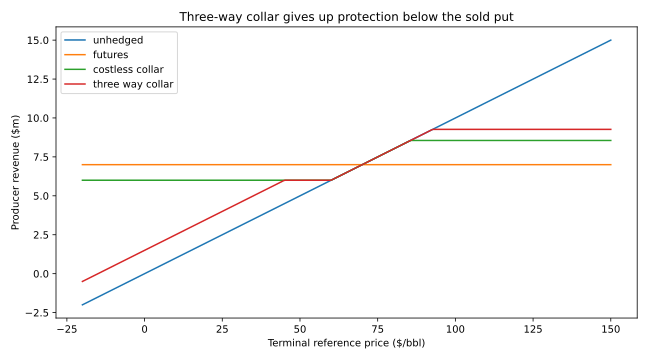

# WTI producer hedge simulator

How much of a crude producer's price risk can WTI futures remove, and what is left over?

**Short answer: almost all of the flat-price risk, and the leftovers are basis, production and the shape of the protection you chose.** The statistically best hedge ratio in the historical test came out at **1.016**, which is just a full hedge. That is the expected answer, because the futures contract settles into physical WTI at Cushing and this model uses Cushing spot as the producer's price. The interesting questions are the ones a full hedge does not answer.

## What the results show

For a producer selling 100,000 barrels a month, a full futures hedge removes about **98%** of the variance of revenue surprises (140 months to September 2026). Re-estimating the hedge ratio every month leaves $0.856/bbl of residual standard deviation against $0.864/bbl for a fixed full hedge: a difference so small that the extra modelling is hard to justify.

Two cautions. Month-end spot and futures are now taken on the same day; an earlier version paired 31 July 2026 spot with a stale 10 July futures price, which inflated the basis and cut the measured effectiveness to 96% (corrected in October 2026). And the futures leg uses a continuous front-month proxy: WTI futures expire around the 20th, so each month-end-to-month-end change spans two contracts and includes a calendar spread a real hedger, rolling a dated contract, would not earn exactly.

[Historical result tables](outputs/README.md) · [Walk-forward validation](docs/validation.md)

### Swaps and collars

A producer who does not want to give up all the upside can buy a floor and pay for it by selling a ceiling. With a $70 forward, a $60 floor, 40% volatility, one year to expiry and 100,000 barrels, the ceiling that makes the collar free is **$85.54** (priced with Black-76). Selling a second put at $45 lifts the ceiling to **$92.67**, but below $45 the producer is unprotected again. The table shows what each structure pays if the price ends the year at $20.

| Structure | Revenue at a $20 terminal price, zero basis |
|---|---:|
| Unhedged | $2.0m |
| Full futures hedge | $7.0m |
| Fixed-price swap | $7.0m |
| Costless collar | $6.0m |
| Three-way collar | $3.5m |



In the bad 5% of simulated outcomes, the collar averages **$6.00m** of revenue and the three-way structure **$4.35m**: the higher ceiling was bought with the tail. Futures and swaps pay the same at expiry here; in practice they differ in margin calls, funding and credit.

[Comparison and assumptions](outputs/structures/README.md) · [Instrument methodology](docs/hedge_structures.md)

### Basis

The hedge covers the futures price, not the price the producer actually gets. Over 140 months, Cushing spot minus the front-month futures proxy averaged $0.30/bbl with a $0.91/bbl standard deviation (median $0.01), and that is at the delivery point itself; a producer in the Permian also carries the Midland-to-Cushing spread. Location-basis scenarios are stressed separately.

[Observed benchmark basis](outputs/structures/observed_benchmark_basis.csv) · [Location stress grid](outputs/structures/basis_stress.csv)

### Two side projects on the physical market

[Crude-storage carry](projects/crude-storage-carry/README.md): when does the futures curve pay you to store crude? The curve was upward-sloping (contango, front month to fourth) in 59 of 111 months, but only 12 of those paid for storage, financing, insurance and handling at the assumed costs. In 10 of those 12 months Cushing inventories rose, against 46 of the other 99 months, which is the behaviour you would expect if traders act on the same arithmetic.

[Crude export arb](projects/crude-export-arb/README.md): when does Brent pay for piping Cushing crude to the Gulf Coast and shipping it to Europe? Open in 44 of 129 months (2016 to September 2026) at base costs, yet exports kept flowing in the years the screen calls closed. Treating committed pipeline tariffs as already paid lifts the count to 59, which is probably closer to how shippers see it.

## Run it

```bash
pip install -r requirements.txt
pytest
python run_structures.py
cd projects/crude-storage-carry
python -m unittest -v test_model
python run_analysis.py
```

The structure and carry analyses run from saved inputs. To refresh the spot and futures history, run `python run_analysis.py` from the repository root (it needs FRED and Yahoo). The EIA curve data ends in April 2024 because that series was discontinued; the carry study drops the partial final month.

The notebooks also cover hedge ladders, production uncertainty, P&L attribution, term structure, bootstrap intervals and walk-forward hedge ratios. Start with [the notebook guide](notebooks/README.md) or [methodology](docs/methodology.md).

## What I learned / what I would do differently

When both sides of a hedge reference the same place, a ratio near one is the sanity check, not the finding. I would spend the next data budget on physical location prices and dated contract settlements before optimizing that ratio any further. And a "costless" collar is not free protection: the option you sold decides where you are exposed again.

Next: an observed Midland-Cushing series, monthly average-price settlement the way producers actually sell, and volume, margin and credit limits. The VaR project's [April 20, 2020 note](https://github.com/akilatrades/energy-commodity-var-engine/blob/main/docs/backtest_diagnosis.md#april-20-2020-the-exception-to-explain-first) is why an explicit contract-roll policy comes before any more hedge-ratio work.

Data, pricing and operational boundaries are collected in [Limitations](docs/limitations.md). The storage project's assumptions and limits are documented with its results.
