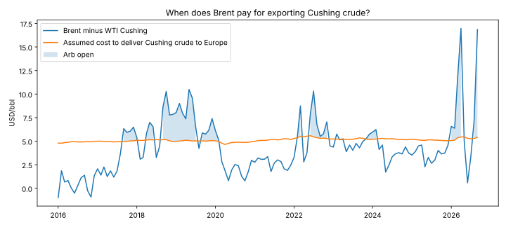

# When does Brent pay for exporting Cushing crude?

A wide Brent–WTI spread does not by itself make an export profitable. The barrel still has to be piped to the Gulf Coast, loaded, shipped across the Atlantic, insured and financed.

In 129 full months from January 2016 to September 2026, the monthly Brent–WTI Cushing spread averaged **$4.38/bbl**, against **$5.11/bbl** of assumed cost to deliver Cushing crude to Europe. Under those assumptions the arb was open in **44 of 129 months**. The median spread could have paid at most **$1.71/bbl** for freight, below the $3.00 assumed.



## By year

| Year | Mean spread | Mean delivered cost | Open months | Mean breakeven freight |
|---|---:|---:|---:|---:|
| 2016 | 0.40 | 4.91 | 0 of 12 | −1.50 |
| 2017 | 3.36 | 4.98 | 4 of 12 | 1.38 |
| 2018 | 6.12 | 5.11 | 8 of 12 | 4.01 |
| 2019 | 7.37 | 5.04 | 11 of 12 | 5.33 |
| 2020 | 2.53 | 4.87 | 2 of 12 | 0.66 |
| 2021 | 2.69 | 5.14 | 0 of 12 | 0.55 |
| 2022 | 5.99 | 5.39 | 8 of 12 | 3.60 |
| 2023 | 4.83 | 5.23 | 3 of 12 | 2.60 |
| 2024 | 3.98 | 5.22 | 2 of 12 | 1.75 |
| 2025 | 3.64 | 5.12 | 0 of 12 | 1.53 |
| 2026 (Jan–Sep) | 8.29 | 5.30 | 6 of 9 | 5.99 |

USD/bbl. Breakeven freight is the most the spread could pay for the ocean voyage after every other cost. The spread was at its widest in April 2026 ($16.97) and September 2026 ($16.85).

[Monthly detail](outputs/arb_history.csv) · [Annual summary](outputs/annual_summary.csv) · [Cost sensitivity](outputs/cost_sensitivity.csv) · [Assumptions](outputs/assumptions.json)

## The screen says closed; the barrels kept moving

The screen shows the arb shut for all of 2021 and 2025, yet US crude exports continued in both years. The gap is the useful part. A Cushing-based screen with constant tariffs misses how exporters actually make the decision:

- **Committed pipeline space is a sunk cost.** A shipper paying a ship-or-pay tariff owes it whether or not the barrel moves, so the marginal export decision ignores it. Setting the pipeline cost to zero lifts open months from 44 to 59 at $3.00 freight.
- **Exporters buy at the coast or in the basin, not at Cushing.** Houston and Midland barrels have their own differentials to Cushing, which this screen does not observe.
- **Freight moves.** At $2.00 freight and a sunk pipeline, 85 of 129 months are open; at $5.00 with a full tariff, only 17.

| Pipeline $/bbl | Freight $1.50 | $2.00 | $3.00 | $4.00 | $5.00 | $6.00 |
|---|---:|---:|---:|---:|---:|---:|
| 0.00 (sunk) | 93 | 85 | 59 | 44 | 31 | 17 |
| 0.50 | 85 | 70 | 49 | 38 | 21 | 14 |
| 1.00 (base) | 70 | 59 | 44 | 31 | 17 | 11 |
| 1.50 | 59 | 49 | 38 | 21 | 14 | 8 |

Open months out of 129.

## Economics

Per barrel, with WTI bought at Cushing and sold against Brent:

`arb margin = Brent − WTI − pipeline − terminal − freight − WTI × loss rate − WTI × (exp(r × days/365) − 1)`

| Input | Default assumption |
|---|---:|
| Pipeline, Cushing to Gulf Coast | $1.00/bbl |
| Terminal and loading | $0.50/bbl |
| Freight, Gulf Coast to Northwest Europe | $3.00/bbl |
| Losses and insurance | 0.2% of cargo value |
| Financing, continuously compounded | 6% a year |
| Days from purchase to sale | 45 |

The costs are round-number assumptions held constant, not observed quotes; the sensitivity table shows how much the answer depends on them.

## Data

EIA daily spot prices: Europe Brent FOB ([RBRTE](https://www.eia.gov/dnav/pet/hist/RBRTEd.htm)) and WTI Cushing FOB ([RWTC](https://www.eia.gov/dnav/pet/hist/RWTCD.htm)), retrieved through the public-domain [datasets/oil-prices](https://github.com/datasets/oil-prices) mirror on October 13, 2026 and filtered from January 2016. Checksums are in [`data/retrieval.json`](data/retrieval.json) and [`outputs/assumptions.json`](outputs/assumptions.json).

Each month averages the days each series was published. A full month with fewer than 15 observations in either series fails rather than being filled. October 2026 is partial and excluded. The sample starts in 2016 because US crude exports were restricted until the ban was lifted in December 2015.

## Run it

From this directory:

```bash
pytest test_model.py
python run_analysis.py
```

## What I learned / what I would do differently

The first answer was that the arb was usually closed, which cannot be right for a country that kept exporting. Working out why taught more than the spread itself: tariffs that are already paid for do not belong in the marginal decision, and the price that matters is where the exporter buys, not the benchmark. Next I would replace Cushing with Houston and Midland differentials, use dated Brent with the right loading window, and add observed Aframax freight.

## Limitations

This is an economics screen, not an executable backtest. Monthly averages hide the timing between buying at Cushing and selling a cargo weeks later. Quality differences between WTI and the Brent basket, terminal and berth availability, cargo size, demurrage, credit and the forward curve are omitted.
